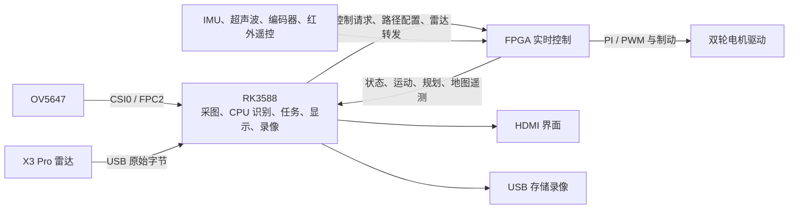

# 系统架构

## 数据与控制分工

FPGA 是实际轮端控制核心。RK 发送请求并管理识别与任务流程；控制源仲裁、反馈检查、轮速调节与停车逻辑在 FPGA 中执行。

当前图像链路是 OV5647 → RK。[`video_top.v`](../robot_rebuild/fpga/rtl/video_top.v) 等 DVP/UDP 代码仍保留，但当前没有 FPGA 直接采图的验收结论。RK 出图不能证明该链路有效。

## FPGA 模块

入口为 [`robot_top.v`](../robot_rebuild/fpga/rtl/robot_top.v)，工程和约束位于 [`fpga`](../robot_rebuild/fpga)。

| 模块 | 主要职责 |
| --- | --- |
| `command_rx`、`nav_config_rx`、`ir_remote` | 串口控制、路径配置和红外遥控输入 |
| `motion_feedback`、`heading_control` | 运动反馈与航向控制 |
| `safety_control`、`turn_travel_guard` | 停车、扫描绕障、超时与转向行程保护 |
| `navigation` | 路径点位置与到点状态处理 |
| `wheel_control` | 双轮速度 PI、输出限制和 PWM |
| `lidar_bridge_rx`、`lidar_x3`、`lidar_scan_map` | 雷达转发帧、原始包解析和 36 格覆盖地图 |
| `lidar_envelope`、`lidar_lattice`、`lidar_controller` | 动态距离、固定几何候选及接管仲裁 |
| `telemetry_tx` | 各类诊断与地图帧输出 |

导航与扫描绕障采用独立编码器航向；手动和人员跟随的主航向仍采用 IMU，未开启全局 IMU 融合。每米计数、轮距、车体包络、减速度和链路预算均需按实物标定。

## 两套候选计算

`predictive_motion` 是原有轮速响应预测：三路、九候选，名义预测时域 160 ms；当前航向评分增益为 0，`PRED_MODEL_VALIDATED=0`。

`lidar_lattice` 使用左弧/直行/右弧与 2/6/12 速度组构成九个固定几何候选。新雷达控制门生效时，受限目标直接送入原轮速 PI，绕过旧航向/预测路径；其他范围保留原控制路径。revision18 使用目标接受握手和双轮屏障，维持 STOP、故障和制动的优先级。

二者的离线计算、时序收敛或遥测输出，都不代表物理模型已经标定。

## 观察模式与地图显示

源码默认参数如下：

| 参数 | 默认值 | 含义 |
| --- | --- | --- |
| `LIDAR_USB_FORWARD` | `1` | 使用 RK 转发的雷达原始字节 |
| `LIDAR_PLANNER_ENABLE` | `1` | 启用规划计算/诊断 |
| `LIDAR_CONTROL` | `0` | 关闭雷达参与运动控制 |
| `LIDAR_ADVANCED_CONTROL` | `0` | 关闭新动态控制 |
| `LIDAR_MODEL_VALIDATED` | `0` | 模型未完成实物验证 |
| `LIDAR_MAP_DISPLAY` | `0` | 默认源码不单独开启地图遥测 |

已部署记录中的 `observe_map` 固件通过 `LIDAR_MAP_DISPLAY=1` 输出地图，三个运动接管门仍为 0。显示开关只启用 C9 地图发送，不启用运动接管。默认构建与这一已部署配置的区别见 [构建说明](BUILD.md)。

新接管逻辑将必需区域的未知格视为未知，不视为可通行；缺图、无可用路径或控制撤销时有停车处理。既有超声波策略则允许缺测时不因该探头阻止运动，两类策略不能互相替代。

## RK 模块与协议

[`hdmi_camera.py`](../ch341_driver_work/hdmi_camera.py) 组合 GTK 界面与 [`rk`](../robot_rebuild/rk) 下的模块：

- `camera_capture`、`ov5647_raw_capture`：相机配置与采集。
- `detector`：OpenCV DNN CPU 推理，保留 COCO `person=0`、`bottle=39`。
- `follow`、`navigation`、`mission`：目标跟随、路径会话、预设地点任务。
- `protocol`、`usb_lidar`：串口协议、遥测新鲜度和雷达 USB 转发。
- `lidar_planning`、`lidar_map_view`：规划诊断和地图显示。
- `video_recording`、`recording_overlay`：USB 分段录像与中文数据叠加。

主串口为 115200、8N1，只应由一个进程持有。控制、路径配置、雷达转发与诊断使用独立帧类型并校验 CRC。C8 为雷达规划诊断，C9 为同一扫描圈的 36 扇区地图；地图每格 10°，车头零位起顺时针排列。以 [`protocol.py`](../robot_rebuild/rk/protocol.py) 和 RTL 的编码/解析实现为准。

UART 活动控制约每 100 ms 发送心跳，FPGA 对有效控制命令设置失联停车条件。红外方向键采用点按锁存，不能把 UART 的静默超时当作红外松键停车机制。

## 离线工具

[`export_lidar_planning.py`](../robot_rebuild/tools/export_lidar_planning.py) 只读取已有 UART 二进制文件，导出 C8 CSV 和摘要。它不会打开串口、启动运动或证明当前在线；输出中的 `live_status` 和 `physical_validation` 保持 `not_assessed`。
